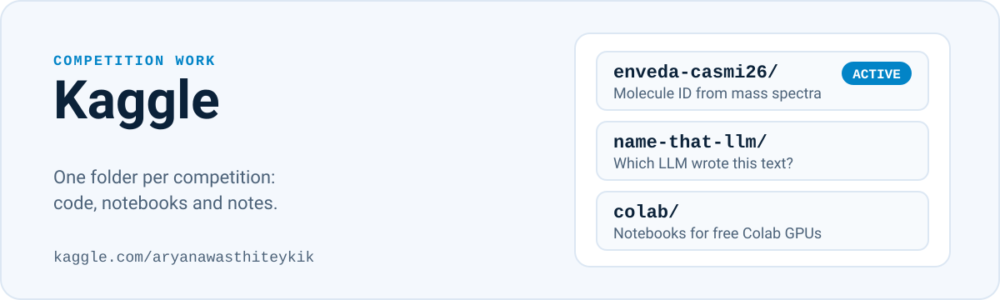

  

My Kaggle competition work ([profile](https://www.kaggle.com/aryanawasthiteykik)). One folder per competition.

| Competition | Folder | Status |
|---|---|---|
| [Enveda CASMI 2026: Molecule ID From Mass Spectra](https://www.kaggle.com/competitions/enveda-CASMI26-molecule-id-mass-spectra) | [`enveda-casmi26/`](enveda-casmi26/) | Active (ends 14 Dec 2026) |
| Name That LLM | [`name-that-llm/`](name-that-llm/) | Code and notebooks |
| Training notebooks for free Colab GPUs | [`colab/`](colab/) | Notebooks |

Earlier work: [SHL spoken grammar scoring](https://github.com/Techy-A/shl-grammar-scoring).
